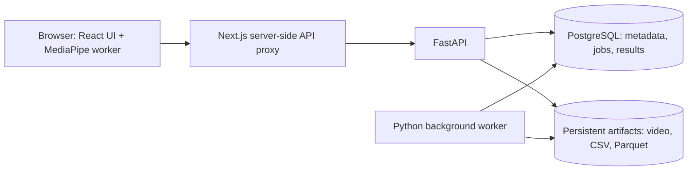

# RallySense Lab

**A full-stack tennis movement research workbench for comparing video pose observations with wearable motion signals.**

[Open the live demo](https://lucky-band-a550.adithya-v1833.workers.dev/) | [Architecture](docs/ARCHITECTURE.md) | [Research methodology](docs/RESEARCH_DESIGN.md) | [Local setup](docs/LOCAL_DEVELOPMENT.md)

RallySense Lab investigates a practical question: **when video and an inertial sensor observe the same movement, how closely do their detected events agree, and what happens when timing or data quality deteriorates?** It brings ingestion, pose extraction, signal processing, synchronized replay and reproducible experiments into one application.

The project includes a local research application and a separately deployed, interactive static showcase. The public demo uses explicitly synthetic data. It demonstrates the software and its failure cases; it does not establish real-world tennis accuracy.

## Explore the demo in two minutes

No account, installation or sensor hardware is required.

1. **[Replay](https://lucky-band-a550.adithya-v1833.workers.dev/#/replay):** play the generated motion video, seek the timeline and inspect the synchronized pose, IMU charts and event markers. IMU means inertial measurement unit: an accelerometer and gyroscope.
2. **[Sensor Fusion Challenge](https://lucky-band-a550.adithya-v1833.workers.dev/#/challenge):** explore ten stored scenarios across video-only, IMU-only and temporal-association modes, including deliberately degraded inputs.
3. **[Compare experiments](https://lucky-band-a550.adithya-v1833.workers.dev/#/compare):** compare stored results, inspect matched and missed events, follow failure examples back to replay and open reports.
4. **[Methodology](https://lucky-band-a550.adithya-v1833.workers.dev/#/methodology):** review provenance, definitions and limitations. Reports provide JSON/Markdown downloads and browser printing.

| Aspect | Public showcase | Full-stack research application |
| --- | --- | --- |
| Purpose | Explore the project immediately | Ingest recordings and run experiments locally |
| Runtime | Vite/React static assets on Cloudflare | Next.js, FastAPI, PostgreSQL and a Python worker |
| Data | Generated video, analytical pose, synthetic IMU and precomputed results | User-provided video/CSV plus labeled synthetic fixtures |
| Processing | Replays and compares stored results | Actual browser MediaPipe extraction and backend numerical processing |
| Uploads and new experiments | Unavailable | Implemented in the local workspace |

## What the research application implements

- **Data ingestion:** video upload and validation, mapped accelerometer/gyroscope CSV import, preserved raw inputs and normalized Parquet artifacts.
- **Browser pose extraction:** MediaPipe Pose Landmarker runs on sampled video frames in a Web Worker, with a CPU main-thread fallback if worker initialization fails. Observations retain actual media timestamps and quality information.
- **Synchronized analysis:** video, pose overlays, sensor plots and event navigation share a session clock. Saved alignment offsets and human annotations support review.
- **Numerical event detection:** filtered gyroscope-magnitude peaks and torso-normalized, two-dimensional wrist-speed peaks calculated from stored landmarks.
- **Multimodal association:** one-to-one event matching within a timing tolerance. A dynamic-programming matcher maximizes valid pairs, then minimizes total absolute timing error.
- **Reproducible experiments:** input/configuration manifests, frozen reference snapshots, seeded corruption, stored results, comparisons and exports. Eligible reference comparisons calculate precision, recall, F1 and timing errors.
- **Background processing:** a durable PostgreSQL job queue with leases, heartbeats and guarded result publication for video validation, sensor normalization and experiments.

## Architecture



MediaPipe runs in the visitor's browser in the full-stack application. The Python worker processes uploaded sources and stored pose observations; it does not run MediaPipe. The public static showcase operates independently of this backend.

| Component | Main technologies |
| --- | --- |
| Research frontend | Next.js 16, React 19, TypeScript, TanStack Query, Recharts, Tailwind CSS |
| Browser pose processing | `@mediapipe/tasks-vision`, Web Workers, video frame callbacks |
| API and validation | Python 3.13, FastAPI, Pydantic, FFmpeg/FFprobe |
| Scientific processing | NumPy, SciPy, PyArrow |
| Persistence | PostgreSQL 17, SQLAlchemy, Alembic, persistent artifact storage |
| Public showcase | Vite, React, TypeScript, static JSON/video/report assets |
| Verification and packaging | pytest, Vitest, Playwright, axe-core, Docker Compose |

Exact versions are recorded in the dependency manifests and lockfiles.

## Run locally

### Static showcase

Requires Node.js 24 and npm. From the repository root:

```sh
npm --prefix apps/showcase ci
npm --prefix apps/showcase run build
npm --prefix apps/showcase run preview
```

Open **http://127.0.0.1:14173/**. Committed synthetic assets are sufficient; no database, private recordings or model download is needed.

### Full-stack application

Requires Docker with Linux containers. From the repository root:

```sh
docker compose up -d --build
docker compose ps
```

Open **http://127.0.0.1:3000**. API documentation is at **http://127.0.0.1:8000/docs**. Choose **Explore the demo**, or create a session and import your own permitted recordings.

The first build needs internet access for images, dependencies and checksum-verified MediaPipe assets. Startup applies database migrations. PostgreSQL and recording artifacts persist in named Docker volumes. Default credentials and loopback bindings are for local development; the upload-enabled workspace is not approved as an anonymous public service.

See [detailed setup and troubleshooting](docs/LOCAL_DEVELOPMENT.md). Use `docker compose stop` to stop services while preserving data.

## Source guide

| Start here | Responsibility |
| --- | --- |
| [`apps/web/src/features/replay/workbench.tsx`](apps/web/src/features/replay/workbench.tsx) | Research session UI, replay state and processing controls |
| [`apps/web/src/features/replay/pose-extraction.ts`](apps/web/src/features/replay/pose-extraction.ts), [`pose-worker.js`](apps/web/public/pose-worker.js) | Actual browser MediaPipe inference and batch submission |
| [`apps/web/src/app/api/v1/[...path]/route.ts`](apps/web/src/app/api/v1/%5B...path%5D/route.ts) | Server-side API proxy, request limits and access checks |
| [`signals.py`](apps/api/src/rallysense/signals.py), [`research.py`](apps/api/src/rallysense/research.py) | IMU processing, video events, matching, association and evaluation |
| [`experiments.py`](apps/api/src/rallysense/experiments.py) | Executes experiments against recorded inputs and manifests |
| [`jobs.py`](apps/api/src/rallysense/jobs.py), [`worker.py`](apps/api/src/rallysense/worker.py) | Job claiming, leases, execution and result publication |
| [`models.py`](apps/api/src/rallysense/models.py), [`storage.py`](apps/api/src/rallysense/storage.py) | Database records and artifact persistence |
| [`apps/showcase/src/main.tsx`](apps/showcase/src/main.tsx) | Separate public showcase, replay, comparisons and report views |

## Verification

The repository contains backend unit/integration tests, frontend unit tests and Chromium end-to-end tests. The [recorded public acceptance run](docs/FINAL_LIVE_ACCEPTANCE.md) passed **19 tests with 0 failures and 0 skips** on November 9, 2026. That is historical evidence for the deployed static release, not a claim of current uptime or model accuracy.

For example, after installing the showcase dependencies:

```sh
npm --prefix apps/showcase run typecheck
npm --prefix apps/showcase run lint
npm --prefix apps/showcase test
```

See [testing instructions](docs/TESTING.md) for backend and browser suites, prerequisites and historical failures. Some full-stack browser checks require separately acquired verification footage that is intentionally excluded from Git.

## Scientific scope and limitations

- Gyroscope peaks are measured angular-speed events. They are **not confirmed tennis swings**.
- Video events are image-space wrist-speed peaks. They are **not ball contacts, calibrated physical speeds or validated biomechanics**.
- MediaPipe is a pretrained pose estimator. This project does not contain a trained tennis stroke classifier.
- Temporal association compares events after alignment; it does not prove that both sensors observed the same physical action.
- Camera viewpoint, occlusion, sampling gaps and pose errors can limit coverage or create misleading peaks. Successful processing alone does not establish reliable detection across a recording.
- Synthetic fixtures test software behavior. Independent paired tennis data, reference labeling and real-world accuracy validation remain future work. Accuracy is unavailable when an experiment lacks an eligible reference.

For deeper review: [research design](docs/RESEARCH_DESIGN.md), [inference contracts](docs/INFERENCE_CONTRACTS.md), [known limitations](docs/KNOWN_LIMITATIONS.md), [architecture decisions](docs/DECISIONS.md) and [third-party notices](docs/THIRD_PARTY_NOTICES.md). Stage reports preserve historical decisions and release gates; the static showcase and upload-enabled workspace have different deployment boundaries.
