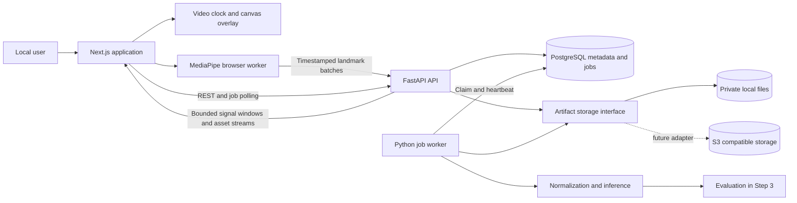

# Architecture

Updated for Step 3 on 2026-11-05. The local Next.js/FastAPI/PostgreSQL foundation is preserved. Research inference, event evaluation and experiments extend the same API, worker and storage. See [research implementation](RESEARCH.md), [experiment guide](EXPERIMENTS.md), and [project status](PROJECT_STATUS.md). The approved original design is retained below where it describes future extensions.

## Implemented research extension

`research.py` contains pure video/IMU observation processing, interval-aware temporal association, seeded corruption and deterministic event matching. `experiments.py` resolves immutable sensor/pose Parquet, verifies SHA-256 identities, executes those functions and produces stored results/reports. `api/research.py` provides typed creation/history/evaluation/comparison/export and frozen annotation snapshots. The ordinary PostgreSQL job worker executes research jobs with the existing lease, heartbeat, cancellation and publication fencing; no new service or broker is introduced.

The additive `a496e751b8a9` migration adds `reference_snapshots` and `experiments`, including same-session foreign keys. Reference events and experiment manifests/results are small JSONB records; sensor/pose datasets are referenced by stable artifact ID/hash rather than duplicated. Completed results and snapshots have no update API. Draft annotation-set revision advances on create/edit/delete. Re-evaluation creates a new experiment, preserving the original snapshot and metrics. Session deletion removes dependent research metadata before its sources.

All database dependencies use FastAPI function scope so transaction commit/rollback finishes before HTTP response headers. This fixes a directly observed create-then-GET race and prevents reporting success when persistence fails. A real PostgreSQL/ASGI test queries a separate connection at `http.response.start` and verifies commit visibility; an injected transaction failure produces an error response and no persisted row. This follows [FastAPI's documented dependency scopes](https://fastapi.tiangolo.com/tutorial/dependencies/dependencies-with-yield/#early-exit-and-scope).

The replay workbench includes a Sensor Fusion Challenge tab. It polls actual experiments and renders stored component signals, prediction/reference timelines, measured latency, quality, eligible coverage, metrics, errors, configurations and report downloads. Markers seek the existing replay clock. Missing gyro/pose inputs and unrelated mixed-source fusion are disabled. The generated paired fixture is a separate synthetic session with explicitly analytical landmarks, not a substitute for actual MediaPipe integration.

MediaPipe extraction supports the original 10 Hz target and an optional 30 Hz target at half-speed playback. Both retain actual presentation times, measured cadence/gaps and explicit worker/fallback executor metadata. These remain sampling targets, not exhaustive-decoding guarantees. Offset-only synchronization is retained; drift estimation is not implemented. The association method preserves both event times and keeps the IMU anchor rather than averaging different event definitions.

## Scope and boundaries

Build one local monorepo with a Next.js web application and a modular FastAPI backend. A worker process imports the same Python application modules and claims durable jobs from PostgreSQL; it is not a separate service domain. Browser MediaPipe handles pose extraction. Python handles sensor normalization, numerical inference, and later evaluation. No Redis, cloud service, trained movement model, or GPU is necessary for the MVP.

Step 2 implements ingestion, real pose processing, an IMU baseline, manual alignment, replay, annotations, and a synthetic demonstration. Step 3 adds video event detection, temporal association, experiments and evaluation. Phone recording completion and product hardening remain Step 4. Step 5 independently audits the result. The user must authorize each subsequent stage.

## Planned layout and ownership

| Path | Responsibility |
| --- | --- |
| `apps/web/src/app` | App Router routes and server-rendered shell |
| `apps/web/src/features/{sessions,ingestion,replay,annotations}` | Feature UI and state boundaries |
| `apps/web/src/workers` | MediaPipe extraction and transferable frame messages |
| `apps/web/src/lib` | API client, timeline mapping, capability detection |
| `apps/api/src/rallysense/api` | FastAPI routers, request validation, errors |
| `apps/api/src/rallysense/{models,services,storage,jobs}` | Persistence, use cases, artifact access, job lifecycle |
| `apps/api/src/rallysense/{ingestion,inference,sync,evaluation}` | Independent computational modules |
| `apps/api/migrations` | Reviewed Alembic migrations |
| `packages/shared-contracts` | Generated OpenAPI TypeScript types and contract version |
| `research/{experiments,evaluations}` | Versioned manifests and reproducible analysis entry points |
| `data/{demo,fixtures}` | Small explicitly synthetic, redistributable inputs |
| `scripts`, `tests`, `infrastructure`, `docs` | Developer workflows, integration tests, containers, documentation |

Python Pydantic models own API schemas. Generate frontend types from OpenAPI and fail CI on drift. Do not independently maintain equivalent handwritten request types. Computational modules accept arrays and immutable typed descriptors, not HTTP objects or database sessions.

## Frontend

Use Next.js App Router, strict TypeScript, React, Tailwind, Radix primitives, Lucide, Recharts, and TanStack Query. Server components render the shell; browser-only modules own media, sensors, charts, and workers. Query owns server state and cache invalidation. A small replay controller owns time, seeking, speed, and selected channels; high-frequency clock updates use refs/subscriptions rather than rerendering the entire route.

Serve private media and API responses without public caching. Use a same-origin `/api/v1` reverse-proxy path in the planned container setup; native development may use an explicit localhost API origin with an exact CORS allowlist. No public CDN receives uploaded recordings. Vendor the pinned MediaPipe WASM and approved model asset locally, retaining license and SHA-256; model download and licensing remain Step 2 checks.

### Pose extraction

The browser decodes a supported uploaded video and forwards `ImageBitmap` frames with actual media timestamps to a dedicated worker. Use MediaPipe VIDEO mode, one subject, and an explicit dominant-hand/subject selection. Close transferred bitmaps. Keep one inference in flight; record dropped or unsampled frames, never fabricate coverage. A new extraction or backward seek resets the task state to maintain increasing timestamps.

Playback-based extraction is a bounded MVP approach, not guaranteed exhaustive decoding. Prefer a slow, sequential extraction pass with backpressure. Record the actual timestamp of every processed frame, coverage, configuration, model hash, browser, and backend delegate. If playback throttling leaves excessive gaps, mark the track degraded and offer retry. A later decoder using demuxed presentation timestamps is an extension, not an MVP dependency. Browser interruption produces an incomplete track; retry starts a new track rather than splicing incompatible temporal tracker states.

MediaPipe calls are synchronous and suitable for moving off the UI thread; its result includes image and world landmark estimates. This supports the worker choice but does not establish physical measurement accuracy. [Google web guide](https://developers.google.com/edge/mediapipe/solutions/vision/pose_landmarker/web_js)

Use `requestVideoFrameCallback` metadata `mediaTime` for displayed frames, in seconds. The callback's wall-clock argument and `performance.now()` are not video timestamps. Callback cadence can miss source frames, especially at high frame rates. [MDN video frame callback](https://developer.mozilla.org/en-US/docs/Web/API/HTMLVideoElement/requestVideoFrameCallback)

## API and durable execution

FastAPI supplies versioned REST endpoints and OpenAPI. SQLAlchemy transactions own metadata updates. One durable worker is enough initially: claim queued rows with row locking/skip-locked semantics, release the transaction before compute, renew a lease, then publish artifacts and complete the job transactionally. Record attempts, a lease token, heartbeat, cancellation request, and typed failure. A stale worker may not publish after its lease is replaced. Job progress reports measured work units; use an indeterminate state if total work is unknown.

Use explicit idempotency keys for retried mutations and hashes for computational run identity. A retried job writes to a unique temporary location. Final publication checks its lease and session state. Cancelled or deleted-session jobs cannot resurrect artifacts. Client pose jobs use the same visible states but are tagged `executor=browser` and cannot be resumed by the Python worker.

FastAPI's lightweight background-task facility is not the durability boundary for long numerical jobs; the official guidance distinguishes heavier computation. The PostgreSQL queue is a project design choice that avoids adding a broker. [FastAPI background tasks](https://fastapi.tiangolo.com/tutorial/background-tasks/)

## Data paths

1. Create a session with pseudonymous participant, handedness, provenance, and capture notes.
2. Upload video or sensor data into bounded quarantine storage. Validate content, inspect metadata, checksum, and publish an immutable raw artifact. A rejected upload leaves no usable asset.
3. Normalize a sensor import using an explicit column/unit mapping into Parquet; publish sample counts, coverage, and quality. Original bytes remain immutable.
4. Extract pose in the browser and send bounded idempotent batches. Validate schema, frame order, source hash, and limits; finalize one pose artifact and quality report.
5. Save a synchronization revision mapping each source clock to session time. Video is the default timeline origin; an IMU-only session uses its primary sensor origin.
6. Run inference against immutable source and synchronization revisions. Save predictions separately from human annotations.
7. Replay media, signal windows, predictions, and annotations on one session timeline. Downsampling affects visualization only.
8. In Step 3, freeze an experiment manifest, run selected algorithms, match predictions to frozen labels, and save metrics, matched pairs, exclusions, and checksums.

## Storage and lifecycle

PostgreSQL stores identity, metadata, relationships, small event lists, configurations, quality summaries, and run provenance. Immutable raw media/CSV and dense pose/sensor arrays live in private files. Parquet provides typed compressed columns and time-range row-group reads; no time-series database is necessary at the proposed scale. [Apache Arrow Parquet guide](https://arrow.apache.org/docs/python/parquet/parquet.html)

`ArtifactStore` exposes `put_stream`, `open_range`, `stat`, `delete`, and internal-key resolution. API clients use artifact UUIDs, never paths. Files are addressed by server-generated session/artifact keys; checksums verify identity without deduplicating private recordings across sessions. First write a staging file, validate/hash, atomically move, then commit its ready metadata. A crash can leave an orphan; a reconciler handles pending rows and unreferenced staging objects after a grace period. Database transactions cannot atomically commit a filesystem operation.

Retention is local and explicit: ready recordings persist until session deletion; failed staging uploads expire after 24 hours. Deletion tombstones the session, blocks new reads/writes, cancels jobs, and enqueues artifact cleanup. Metadata purge follows successful cleanup; a failed cleanup remains visible and retryable. Backups, if later enabled, need a separately documented retention policy; deletion must not promise immediate backup erasure.

## Security and resource bounds

The MVP is a single-user loopback-only application, not a multiuser public service. Bind published ports to `127.0.0.1`; require a local session credential for mutations, check Origin/Host, and use same-origin cookies with CSRF protection where applicable. CORS is not authorization. Public access is prohibited until identity, ownership checks, quotas, rate limits, and read-only demo isolation are implemented and audited.

Proposed configurable limits: video 500 MiB, 10 minutes, 1920x1080 decoded frames; CSV 50 MiB and 1,000,000 rows; JSON pose batches 2 MiB and 300 frames; one concurrent processing job per local workspace. Enforce limits while streaming and decoding, not just using client headers. Document higher limits as configuration changes. Supported MVP media: probe-validated MP4 H.264 and WebM VP8/VP9 that the active browser can decode. Container validation does not guarantee browser codec support; test playback before extraction. Reject archives in the MVP; users extract phyphox CSVs themselves.

Run FFprobe as an argument array, without shell interpolation, with bounded time/output and local files only. Restrict accepted formats and resource usage. Refuse traversal, absolute client paths, invalid UUID references, symlink escape, nonfinite numeric values, and cross-session references. Stream validated media through controlled range endpoints. Hide private paths and internals in errors; log request/job IDs, sizes, and states, never video contents. Review dependency vulnerabilities and model licenses before implementation acceptance.

## Quality and observability

Quality reports are versioned derived observations: sample rate and jitter, gaps, clipping suspicion, missing channels, pose visibility/coverage, timestamp anomalies, clock mapping residuals, and provenance. A saturation claim requires a known device range. Attach measurable values, units, affected intervals, severity, and detector version. Algorithm eligibility is separate from recording quality: data may be viewable but unsuitable for inference. Unknown quality is never treated as good quality.

Measure upload/normalization time, extraction frames per second and coverage, inference wall time, API response time, and replay frame delays. Record environment and workload with any benchmark; Step 1 contains no performance results.

## Deployment and testing design

Plan Docker Compose services for web, API, worker, and PostgreSQL with private storage and DB volumes, health/readiness probes, nonroot application containers, and a one-shot migration command. Pin dependency locks and container digests during implementation. Separate liveness from database/storage readiness. S3 migration replaces the storage adapter, not computational interfaces. There is no Sites hosting integration: this user-requested local Python/PostgreSQL architecture is outside that hosting runtime and publication is explicitly unauthorized.

Use Pytest for numerics, API, storage safety, and PostgreSQL integration; Vitest/Testing Library for timeline controls and state; Playwright for the synthetic end-to-end flow. Actual browser pose validation needs a licensed real clip and model asset; a mock or synthetic skeleton does not satisfy that check. CI should run type checking, lint, unit/integration tests, migrations, production build, and a Compose smoke test. Test fixtures and expected mathematical outcomes are specified in [implementation plan](IMPLEMENTATION_PLAN.md).
