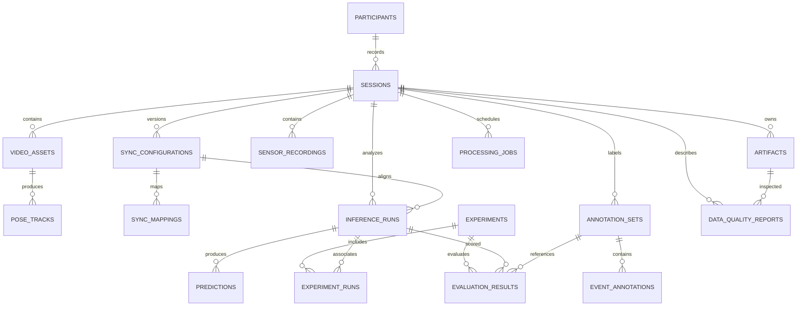

# Database and artifact design

Proposed schema, not migrations. PostgreSQL 17 is the conservative target major; select the supported patched minor and image digest at implementation time. All IDs are UUIDs, all administrative timestamps are UTC `timestamptz`, and all movement times are signed `bigint` microseconds. UTC timestamps never substitute for movement clocks.

Step 2 note: the target design below is retained for future stages. The actual [frozen initial migration](../apps/api/migrations/versions/0001_mvp.py) and [models](../apps/api/src/rallysense/models.py) implement the MVP subset on PostgreSQL 17.11. UUID values are represented as validated 36-character strings; same-session composite foreign keys enforce ownership. Manual offset mappings are stored directly on synchronization revisions. Experiment/evaluation tables and frozen annotation snapshots remain Step 3. Temporary bounded pose batches use JSONB and are removed after Parquet finalization. See STEP2_REPORT for the implementation mapping.

## Relational entities

Unless stated otherwise, every session-owned table carries `session_id`, `created_at`, and an ID. Composite foreign keys `(session_id, referenced_id)` enforce same-session references, backed by corresponding unique constraints. JSONB is for versioned small configurations, not dense time series. Finite-number validation is enforced at the API/worker boundary as well as applicable database checks.

| Entity | Key fields and relationships | Constraints / lifecycle |
| --- | --- | --- |
| `participants` | `id`, unique `pseudonym`, optional handedness, notes | No name, birthday, contact, or medical details required; one participant can have many sessions |
| `sessions` | `participant_id` nullable, title, `dataset_kind`, dominant hand, capture metadata, lifecycle state, `deleted_at` | `dataset_kind=recorded/synthetic/mixed`; deletion is a state transition; unknown provenance cannot become recorded implicitly |
| `artifacts` | `session_id`, internal storage key, kind, schema version, SHA-256, bytes, MIME, `state`, parent artifact ID nullable | Unique storage key; `pending/ready/deleting/failed`; path never serialized; session-local ownership, no cross-session deduplication |
| `video_assets` | raw artifact ID, duration, width/height, rotation, codec, rational time base, nominal FPS nullable, first presentation timestamp, optional display proxy ID | Raw and proxy checksums retained; proxy time mapping must be explicit; duration/size positive |
| `sensor_recordings` | raw artifact ID, normalized artifact ID, source format, mapping JSON, clock metadata, placement, coordinate frame, acceleration kind, stream counts/time ranges | Each source stream retains its own timestamps; normalization version and units required; source-to-session alignment is not embedded in the raw artifact |
| `pose_tracks` | video ID, landmark artifact ID, model/runtime hashes, configuration, extraction revision, sampled/valid frame counts, source time range, status | Complete tracks immutable; one video can have multiple tracks; no persistent identity guarantee when multiple people appear |
| `sync_configurations` | revision, `session_id`, method, author, created time, notes, hash | Unique `(session_id, revision)`; immutable after creation |
| `sync_mappings` | sync config ID, source artifact ID, `source_anchor_us`, `session_anchor_us`, `scale`, evidence JSON | Unique config/source pair; finite positive scale; Step 2 scale exactly 1; source anchors and uncertainty retained |
| `annotation_sets` | name, revision, event definition version, author pseudonym, status, source video ID nullable, sync config ID, provenance | Draft edits require revision token; frozen revisions immutable; human and synthetic references distinguishable |
| `event_annotations` | set ID, event type, `t_session_us`, interval bounds optional, uncertainty bounds optional, source frame time, labeler, ambiguous flag | Nonnegative within included session interval; bounds ordered and enclosing event; no inference-run FK |
| `inference_runs` | algorithm name/version, input manifest JSON, config/hash, sync config ID, run fingerprint, status, runtime metadata, started/finished time, latency | Completed runs immutable; fingerprint includes artifacts, code/model/config, sync, and schema versions |
| `predictions` | run ID, event type, event definition version, `t_session_us`, optional interval, score/value/kind, evidence JSON | Unique run/event ordinal; score not automatically probability; evidence identifies source peaks and algorithm eligibility |
| `experiments` | name, immutable manifest artifact, split policy, dataset kind, status, code revision, seed | An experiment may span sessions; immutable manifest references exact input/run/label revisions |
| `experiment_runs` | experiment ID, inference run ID, role, cohort/split | Composite unique association; preserve participant grouping and paired comparisons |
| `evaluation_results` | experiment ID, run ID, annotation set ID, evaluator version/config, tolerance, coverage interval artifact, TP/FP/FN, metrics JSON, match artifact | Nonnegative counts; denominator-zero metrics nullable with reasons; unique fingerprint; enforce run/label session agreement |
| `processing_jobs` | session ID nullable, kind, executor, input manifest, idempotency key, state, attempt, lease token/expiry, heartbeat, progress, output IDs, safe error | `queued/running/succeeded/failed/cancelled`; cancellation request separate; optional run ID; global maintenance jobs may lack session |
| `data_quality_reports` | session ID, detector/version, artifact ID or run ID, summary JSON, detailed intervals artifact nullable | Exactly one target; actual measurements plus units/severity; append-only versions |

Annotations must never be copied from predictions and presented as independently labeled references. A user-assisted copy, if added later, is explicitly tagged `prediction_assisted` and excluded from blinded reference evaluation by default.

The diagram emphasizes domain relationships; the table specifies additional artifact and provenance references. Experiment manifests and their association rows are updated in one transaction before freezing.

## File schemas

Each artifact has a schema version, SHA-256, generating code version, parent hashes, creation time, and provenance. Use Zstandard-compressed Parquet with row groups initially around 64k rows, sorted within source streams by timestamp. Tune only after measurements.

**Sensor Parquet v1:** `stream` (`acceleration` or `gyroscope`), `sample_index:int64`, `t_source_us:int64`, `x/y/z:float64 nullable`, `valid:bool`, `quality_flags:uint32`. Metadata includes original unit/column mapping, raw time origin, monotonic clock description, acceleration kind (`linear`, `including_gravity`, `unknown`), placement, and frame. Separate accelerometer and gyroscope samples need not share timestamps. Preserve raw input to distinguish parser normalization from recording behavior. Invalid rows never silently become zero.

**Pose Parquet v1:** `frame_index:int64`, `t_video_us:int64`, `person_index:int16`, `landmark_index:int16`, normalized `x/y/z:float32`, optional `world_x/y/z`, `visibility/presence:float32 nullable`, and flags. Store a companion frame manifest recording processed frames with no detected person; absence of rows must not ambiguously mean a skipped frame. Use 33-landmark schema identity tied to model contract. Image coordinates, relative depth, and model world estimates have distinct metadata and units.

**Derived feature Parquet:** source time, feature name or typed columns, value, validity, unit, derivation version, and source artifact hash. Exclude interpolated intervals from raw observation claims.

**Evaluation match Parquet/JSON:** prediction ID, annotation ID, signed/absolute error, event type, tolerance, match status, exclusion reason. Small reports can be JSON; bounded large match tables use Parquet. Export manifests include provenance and hashes, but exclude private storage keys and unnecessary personal notes.

## Indexes, queries, and consistency

- Index sessions by `(deleted_at, created_at, id)` and participant; use cursor pagination.
- Index predictions by `(run_id, t_session_us)` and annotations by `(annotation_set_id, t_session_us)`.
- Index jobs by `(state, lease_expires_at, created_at)` with a partial queued-job index; unique idempotency keys within operation/session scope.
- Index artifacts by `(session_id, state)` and checksum for integrity lookup; maintain explicit references before cleanup.
- Index run/config fingerprints and experiment membership. Add JSONB indexes only for demonstrated query patterns.
- Do not store one SQL row per sensor sample or landmark. Time-window API queries use Parquet statistics, bounded batches, and a capped chart representation.
- Use optimistic concurrency on editable session/annotation metadata. Revisions invalidate old UI caches; frozen run references continue to resolve the exact old versions.
- Use foreign-key RESTRICT for referenced immutable versions; session cleanup follows dependency order after tombstoning. Deleting a session invalidates affected cross-session experiment reports and removes its associated artifacts/results; it must not leave an export exposing deleted data. The original experiment manifest can be purged or redacted with an explicit deletion status.
- An active alignment change never rewrites old predictions or labels. It creates a new revision and marks old-run views as using an older alignment. Label rebasing, if needed, creates a new set and retains the previous one.

## Migration and recovery plan

Step 2 migrations initially create session/assets/sensors/pose/sync/annotations/runs/predictions/jobs/quality tables. Step 3 adds experiment and evaluation tables, avoiding unused implemented features early. Run migrations against actual PostgreSQL, including an empty-database upgrade test; SQLite is insufficient evidence for PostgreSQL behavior.

Back up database and artifact manifests consistently before later migrations. Restore verification must compare referenced ready artifacts to stored hashes and detect missing objects. Schema evolution makes a new artifact version; do not mutate raw files or silently reinterpret old units.
